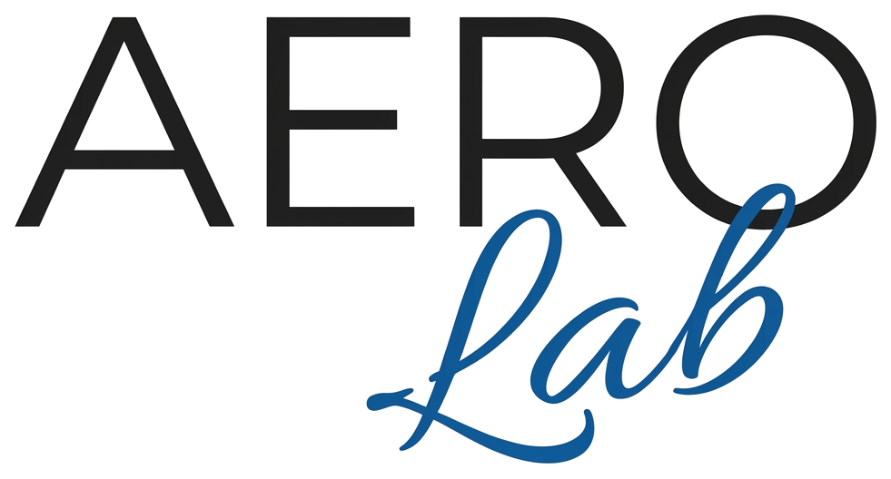

<p align="center">
  
</p>

<h1 align="center">AeroLab — Interactive 3D Wind Tunnel &amp; CFD Workstation</h1>

<p align="center">
  Real-time 3D aerodynamic flow simulator featuring Biot-Savart vortex lattice physics, GLB CAD models, live force telemetry, and responsive controls.
</p>

---

## Key Features

### 1. Interactive Aircraft & Airfoil Models

| Model | Category | Geometry / Asset | Key Capabilities |
| :--- | :--- | :--- | :--- |
| **F-22 Raptor** | Stealth Fighter | `f22_raptor.glb` (741 KB PBR, Meshopt) | High-alpha vortex lift, twin thrust-vectoring nozzles, all-moving tailerons |
| **Boeing 787 Dreamliner** | Commercial Airliner | `boeing_787.glb` (3.9 MB CAD) | Supercritical wing, Fowler flaps (0°–35°), high-bypass nacelles |
| **Concorde SST** | Supersonic Transport | `concorde_free_with_interior.glb` (755 KB PBR) | Ogival delta wing, Mach cone &amp; shockwave physics |
| **NACA 2412** | Cambered Airfoil | `airfoil.glb` (11.4 KB 3D Mesh) | Positive camber lift at 0° AoA, trailing-edge flap deflection |
| **NACA 0012** | Symmetric Airfoil | Parametric 3D Airfoil Geometry | Zero-camber reference section for symmetric stall & lift-curve testing |
| **Circular Cylinder** | Bluff Body Benchmark | Parametric 3D Cylinder | Symmetric boundary-layer detachment and unsteady von Kármán vortex street |

---

### 2. Biot-Savart Vortex Lattice & Real-Vertex Flow Solver

- **3D Surface Distance & Normal Field (`src/engine/AircraftSurfaceField.ts`)**: Extracts triangle meshes and vertices directly from normalized GLB/parametric aircraft geometries, builds a 3D Euclidean Distance Transform (EDT) grid (`64 × 32 × 48`) with trilinear interpolation, and computes smooth $C^1$ surface normals ($\nabla d$) for non-penetrating tangential slip.
- **Biot-Savart Vortex Lattice Solver (`src/engine/FluidDynamics3D.ts`)**: Computes 3D velocity fields using a 6-panel horseshoe vortex lattice with Lamb-Oseen viscous core regularization driven by kinematic viscosity ($\nu$), RK2 midpoint advection for smoke ribbons and PIV streak particles, wingtip helical vortex roll-up, Kutta circulation, and stall wake separation.
- **Dual 3D Rendering Engines**:
  - **Three.js WebGL2 Wind Tunnel (`WindTunnelCanvasWebGL.tsx`)**: Hardware-accelerated PBR rendering, CFD $C_p$ surface pressure heatmap shaders, wireframe overlay, animated smoke streamlines, PIV particle tracers, 3D velocity quiver grid, Mach shock cones ($\mu = \arcsin(1/M)$), and 3D Lift/Drag force arrows.
  - **Automatic Software 3D Canvas Fallback (`WindTunnelCanvas3D.tsx`)**: Uses safe WebGL2 capability probing (`src/utils/webglSupport.ts`) and seamlessly falls back to a custom 3D projection rasterizer when WebGL2 is unavailable.

---

### 3. Real-Time Telemetry, Polars & Data Export

- **Flight Telemetry HUD (`TelemetryHUD.tsx`)**:
  - Lift Coefficient ($C_L$) & Lift Force ($N$ / $kN$ / $MN$)
  - Drag Coefficient ($C_D$) & Drag Force
  - Aerodynamic Efficiency ($L/D$) & Glide Ratio
  - Mach Number ($M$) & Speed Regime (Subsonic, Transonic, Supersonic)
  - Dynamic Pressure ($q = \frac{1}{2}\rho V^2$) in kPa & ISA Standard Atmosphere density ($\rho$)
  - Boundary Layer Flow State & Stall Margin
  - Lift Generation Breakdown: **Upper Surface Suction** vs. **Lower Surface Compression** split and **Downwash Angle ($\epsilon$)**
- **Interactive Polar Curves (`AeroCharts.tsx`)**:
  - Lift Curve ($C_L$ vs. $\alpha$) with stall boundary shading
  - Drag Polar ($C_L$ vs. $C_D$) with maximum $L/D$ tangent guide
  - Chordwise Pressure Distribution ($C_p$ vs. $x/c$)
- **Multi-Format Export (`src/utils/telemetryExport.ts`)**:
  - Telemetry snapshot export as **JSON** (`.json`) and **CSV** (`.csv`)
  - Active polar graph export as **2× High-Res PNG** (`.png`), **Vector SVG** (`.svg`), or **Curve Coordinates CSV** (`.csv`)
  - Direct **PNG Snapshot** capture from both the 3D Wind Tunnel and 3D CAD Inspector

---

### 4. 3D CAD Inspector Modal

Inspect any GLB aircraft asset independently in **`ModelViewerModal.tsx`**:
- Switch between **PBR Shading**, **CFD Pressure ($C_p$) Heatmap**, **Wireframe**, and **X-Ray** views
- Adjust test Angle of Attack, toggle Stall state, Force Vectors, and studio lighting environments (`Wind Tunnel`, `Studio White`, `Warm Key`, `High Contrast`)
- Inspect live mesh group counts, vertex counts, and wingspan specifications

---

### 5. Responsive Workstation Layout & Controls

- **Desktop 3-Column Workstation**: Collapsible left **Simulation Controls** deck, central **3D Wind Tunnel** viewport, and right **Telemetry & Polars** deck.
- **Mobile & Tablet Optimized**: Dynamic `100dvh` full-viewport layout with safe-area padding, top segmented switcher (**Setup** · **3D** · **Data**), touch-friendly sliders, `touch-action: none` 3D orbiting, a docked quick `AoA` / `L/D` / `Pause` bar below the 3D viewport, and full-screen mobile sheets for modals.
- **Procedural Wind Tunnel Audio (`src/utils/audio.ts`)**: Web Audio API pink/brown noise synthesis scaled by airspeed, Mach number, and stall buffet.

#### Keyboard Shortcuts (Desktop)

| Key | Action |
| :--- | :--- |
| `Space` | Pause / Resume simulation |
| `↑` / `↓` | Pitch Angle of Attack ($\pm 0.5^\circ$) |
| `←` / `→` | Adjust Inflow Airspeed ($\pm 15\text{ kts}$) |
| `M` | Toggle procedural wind tunnel audio |
| `R` | Reset simulation parameters |

---

## Governing Aerodynamic Equations

| Principle | Equation | Description |
| :--- | :--- | :--- |
| **Lift Force** | $L = \frac{1}{2}\rho V^2 S C_L$ | Vertical aerodynamic force from bound circulation and pressure differential |
| **Drag Polar** | $C_D = C_{D0} + \frac{C_L^2}{\pi e AR}$ | Parasitic profile drag plus lift-induced vortex drag |
| **Kutta-Joukowski Circulation** | $\Gamma = \frac{1}{2} V_\infty c C_L$ | Bound vortex strength driving Biot-Savart downwash |
| **Bernoulli Pressure Coefficient** | $C_p = 1 - \left(\frac{V}{V_\infty}\right)^2$ | Local surface suction ($-C_p$) and stagnation compression ($+C_p$) |
| **Downwash Angle** | $\epsilon = \frac{2 C_L}{\pi AR}$ | Trailing wake deflection angle (radians) |
| **Mach Cone Angle** | $\mu = \arcsin\left(\frac{1}{M}\right)$ | Half-angle of oblique supersonic shock cone ($M \ge 1$) |

---

## Tech Stack

- **Frontend**: React 19, TypeScript
- **Styling**: Tailwind CSS v4 (`Quicksand`, `Sacramento` / `Pacifico`, and `JetBrains Mono`)
- **3D Graphics**: Three.js (`GLTFLoader` + `MeshoptDecoder`, `OrbitControls`) & Software 3D Canvas Fallback
- **Audio**: Web Audio API
- **Icons**: Lucide React
- **Bundler**: Vite 8

---

## Project Structure

```text
├── public/
│   ├── aerolab-logo.png                     # Brand logo & favicon asset
│   └── models/
│       ├── airfoil.glb                      # 3D Airfoil section mesh
│       ├── boeing_787.glb                   # Boeing 787 Dreamliner CAD GLB
│       ├── concorde_free_with_interior.glb  # Concorde SST CAD GLB
│       └── f22_raptor.glb                   # F-22 Raptor Meshopt-compressed GLB
├── src/
│   ├── components/
│   │   ├── AeroCharts.tsx                   # CL-α, CL-CD drag polar & Cp charts + export
│   │   ├── AeroTheoryModal.tsx              # Aerodynamics & vortex physics guide modal
│   │   ├── ControlsDeck.tsx                 # Model selector, AoA/flaps/envelope & presets
│   │   ├── ModelViewerModal.tsx             # Standalone 3D GLB CAD inspector modal
│   │   ├── TelemetryHUD.tsx                 # Force cards, lift breakdown & JSON/CSV export
│   │   ├── WindTunnelCanvas3D.tsx           # Software Canvas 3D projection fallback
│   │   └── WindTunnelCanvasWebGL.tsx        # Three.js WebGL2 CFD wind tunnel renderer
│   ├── engine/
│   │   ├── AircraftSurfaceField.ts          # 3D EDT surface distance & normal field
│   │   └── FluidDynamics3D.ts               # Biot-Savart vortex lattice & RK2 flow solver
│   ├── types/
│   │   └── aerodynamics.ts                  # Simulation params, model & telemetry types
│   ├── utils/
│   │   ├── aircraft3DGeometry.ts            # Parametric 3D airframe & airfoil builders
│   │   ├── aircraftGlbModels.ts             # GLB registry, Meshopt loader & axis alignment
│   │   ├── airfoilGenerators.ts             # NACA geometry, polar math & ISA atmosphere
│   │   ├── audio.ts                         # Procedural Web Audio wind tunnel synthesis
│   │   ├── telemetryExport.ts               # JSON, CSV, SVG & 2× PNG export utilities
│   │   └── webglSupport.ts                  # Safe WebGL2 probe & renderer helper
│   ├── App.tsx                              # Main workstation shell & responsive layout
│   ├── index.css                            # Theme tokens, fonts & utility classes
│   └── main.tsx                             # React application entry point
├── index.html                               # Document entry, fonts & favicon metadata
├── metadata.json                            # AI Studio applet metadata
├── package.json                             # Dependencies and npm scripts
├── tsconfig.json                            # TypeScript compiler configuration
└── vite.config.ts                           # Vite configuration
```

---

## Local Development

1. **Install dependencies**
   ```bash
   npm install
   ```

2. **Start the development server** (runs on port `3000`)
   ```bash
   npm run dev
   ```

3. **Type-check**
   ```bash
   npm run lint
   ```

4. **Build for production**
   ```bash
   npm run build
   ```

---

## License

Apache-2.0
